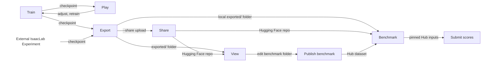

# Cyclotron

<p align="center">
  
</p>

Asimov 1 is an open-source humanoid robot developed by
[Menlo Research](https://menlo.ai/). This repository provides the
training and evaluation code for its locomotion policies, so you can
train policies in simulation and deploy them to the real robot.

Get your own Asimov 1.
[Order now](https://menlo.ai/order).

This repo is a standalone Isaac Lab extension for training Asimov-1 locomotion policies with
PPO and adversarial motion priors (AMP).

## Quick Install

For a brand-new machine with no existing Isaac Lab setup, run the install
script from the project root. It sets up a uv-managed environment, pulls the
pinned Isaac Lab and `asimov-1` submodules, and installs everything needed
to train and play. Prerequisites: Ubuntu 22.04+ (x86_64), a compatible
NVIDIA driver, [uv](https://docs.astral.sh/uv/) installed, and `sudo` access
(used to install `cmake`/`build-essential`).

```bash
git clone https://github.com/menloresearch/cyclotron.git
cd cyclotron
./quick_install.sh
```

The full install takes a while, since it downloads Isaac Sim, PyTorch, Isaac Lab and the Asimov 1 robot model.

#### Advanced Install

If you already have your own Isaac Lab checkout you want
to reuse, want conda instead of uv, or just want to understand what each
install step does: **[Advanced Install](INSTALL.md)**.

## How to use Cyclotron

Cyclotron takes a policy from training through export, viewing and benchmarking,
with simple commands for each step. Each stage name links to its quick start below; each
[docs] link to the full page with every option and advanced examples.

- **[Train](#train)** [[docs](docs/train.md)] — `--train` trains a locomotion
  policy in Isaac Lab, for anyone producing a new policy from the stock tasks
  or from [a task of their own](docs/designing-your-own-task.md).
- **[Play](#play--evaluate)** [[docs](docs/play.md)] — `--play` runs a
  checkpoint live in Isaac Sim to watch and evaluate its behavior, for
  whoever trained it, during and after training.
- **[Export](#export-a-policy)** [[docs](docs/export.md)] — `--export` turns a
  checkpoint into a verified `policy.onnx` bundle for the robot and the
  viewer, for anyone deploying or publishing a trained run.
- **[Share](#share-your-policy)** [[docs](docs/share.md)] — `--share` uploads a
  run to the Hugging Face Hub with a model card, for policies that are ready
  to hand to others.
- **[View](#view-a-policy)** [[docs](docs/view.md)] — `--view` runs an exported
  or shared policy in the browser with MuJoCo, no GPU and no Isaac Sim, for
  anyone who wants to try a policy — including people without a training
  machine.
- **[Benchmark](#benchmark-a-policy)** [[docs](docs/benchmark.md)] — `--benchmark`
  runs reproducible suites, views results, submits scores and publishes benchmark
  folders. Cyclotron owns Hugging Face access; HPV provides simulation and the editor.



<a id="train"></a>

## Train ([docs](docs/train.md))

Before starting a training run, run a quick test to ensure the full pipeline is functional. The following code will fire off a short training run with a small number of environments which should take ~10 minutes on a 4090.

**Quick Test**

This is a small job to see if the full training code is working. These settings should work for most GPUs and finish relatively quickly.

```bash
./cyclotron.sh --train \
    --task Asimov1-Velocity-AMP-v0 --num_envs 128 --headless --max_iterations 100
```

#### Single GPU Training Run

Use this code to replicate the training run for our baseline policy using a single GPU.

**AMP (recommended)**

```bash
./cyclotron.sh --train \
    --task Asimov1-Velocity-AMP-v0 --num_envs 4096 --headless
```

**Plain PPO baseline**

```bash
./cyclotron.sh --train \
    --task Asimov1-Velocity-v0 --num_envs 4096 --headless
```

Useful flags: `--max_iterations <n>`, `--seed <n>`, `--video` (record rollout
clips during training).

Training prints the run directory and a command to resume the run from its
latest checkpoint, at the start and again when training ends or is
interrupted. Resuming starts a new run directory initialised from that checkpoint.

Note: We use 4096 `num_envs` to train our baseline locomotion policy using A6000 or pro 6000. If you hit any out of memory errors, consider lowering the `num_envs`. However, this means that the policy may take longer to converge or may be less stable for the same number of iterations.

The stock tasks are the starting point: to train something of your own, see
[Designing your own task](docs/designing-your-own-task.md).

#### Multi-GPU Training Run

This code runs training via `--distributed` with two GPUs and 4096 environments per GPU. You should adjust the parameters according to the compute available to you.

```bash
python -m torch.distributed.run --standalone --nnodes=1 --nproc_per_node=2 \
    scripts/rsl_rl/train.py \
    --task Asimov1-Velocity-AMP-v0 --num_envs 4096 --headless --distributed
```

<a id="play--evaluate"></a>

## Play / Evaluate ([docs](docs/play.md))

Load the latest checkpoint and visualize the trained policy:

```bash
./cyclotron.sh --play \
    --task Asimov1-Velocity-AMP-Play-v0 --num_envs 32
```

Use `--checkpoint` to select a specific checkpoint (`--target` is an alias).
`--checkpoint` works the same way for `--train`, `--play` and `--export`:
pass a full path to a `.pt` file, or a filename such as `model_500.pt`
together with `--load_run <run>`. `--share` takes the run folder itself, so
there a filename alone is enough. Without it, the latest checkpoint is used. Play runs the checkpoint itself and writes no ONNX; use
[`--export`](#export-a-policy) for that. Before running, play warns about
anything that changed in the code since the run was trained; see
[Code changes since training](docs/code-changes-since-training.md). Play and
export simulate the robot model the run was trained with, fetched by the
commit the run records when your checkout's differs
([details](docs/code-changes-since-training.md#the-robot-model)).

Checkpoints and logs are written to `logs/rsl_rl/<experiment_name>/<run>/`.

<a id="export-a-policy"></a>

## Export a policy ([docs](docs/export.md))

Export a checkpoint to ONNX, the format that runs on the robot and in the
viewer, without uploading anything:

```bash
./cyclotron.sh --export \
    --checkpoint logs/rsl_rl/<experiment_name>/<run>/model_<n>.pt
```

This writes `exported/` next to the checkpoint, with the same files a shared
policy has on the Hugging Face Hub:

- `policy.onnx`: the policy, for the robot and the viewer
- `policy.pt`: the same policy as TorchScript
- `env.yaml` and `agent.yaml`: unchanged copies of the run's `params/`
- `code_state.yaml`: the code the run was trained with, for runs that have one
  (see [Code changes since training](docs/code-changes-since-training.md))

The task is read from the run's `agent.yaml`, so `--checkpoint` is enough. You
can also pick the checkpoint the same way as `--play`, for example
`--task Asimov1-Velocity-AMP-v0 --load_run <run>` for that run's latest
checkpoint. Use `--output <folder>` to write somewhere else. Export runs Isaac
Sim headless with one environment. It then feeds the same observations to the
checkpoint, to `policy.onnx` and to `policy.pt`, and fails if their actions
differ by more than 1e-4 (relative, for values above 1), which would mean the export is broken (for example, a dropped observation
normalizer).

`policy.onnx` also carries a small deployment contract in its ONNX metadata,
so a robot runtime can check its assumptions about the file before driving
the robot with it: the joint order the actions are in, the per-joint scale,
offset and clip that turn raw actions into position targets, the PD gains
(kp/kd) the targets were trained to be tracked with, the policy rate
(`sim.dt` x `decimation`), the input and output widths, the ordered
observation terms, and the commit the run was trained with. It is a
handshake, not configuration: the runtime should verify its own settings
against these values and refuse on mismatch, not configure itself from them.
[docs/export.md](docs/export.md) documents every key, the full export
pipeline, and how to export an Isaac Lab run that was not trained with
cyclotron.

To watch the exported policy in the browser, pass the run folder to
[`--view`](#view-a-policy).

<a id="share-your-policy"></a>

## Share your policy ([docs](docs/share.md))

Share a finished run on the Hugging Face Hub. Log in first with
`hf auth login`.

```bash
./cyclotron.sh --share logs/rsl_rl/<experiment_name>/<run> \
    --repo-id <user_or_org>/<repo_name>
```

This uploads `agent.yaml`, `env.yaml`, `policy.onnx`, `policy.pt`, `code_state.yaml` (for
runs that have one) and a generated `README.md` model card (BSD-3-Clause, `library_name: asimov`,
`pipeline_tag: robotics`). Sharing publishes the policy, so the checkpoint is
always re-exported first with [`--export`](docs/export.md)'s `--strict` checks:
a change to the code of the policy's network, or policy settings the run
didn't save, stop the upload instead of warning, and an
`exported/` folder already on disk is never uploaded (pass `--onnx <file>`
to upload a file as is). Use `--checkpoint` to share a
different checkpoint of the same run (a filename inside the run directory, or a full path to one). Use `--title "<text>"` to set the card's title,
`--summary "<text>"` to add a paragraph describing your training method,
`--private` to create a private repo, and `--dry-run` to preview the card
without uploading.

<a id="benchmark-a-policy"></a>

## Benchmark a policy ([docs](docs/benchmark.md))

```bash
# Run a local suite, or cyclotron's default suite in benchmarks/default (omit ./my-benchmark)
./cyclotron.sh --benchmark <org>/<model> ./my-benchmark --jobs 2

# Inspect the output
./cyclotron.sh --benchmark view logs/benchmark_results/<timestamp>

# Check a run's eligibility and proposed Hub score entries without uploading
./cyclotron.sh --benchmark submit <result-directory> --dry-run
```

Results live in `logs/benchmark_results/<timestamp>/`: HPV's `result.json`
and `report.html`, plus cyclotron's input/revision provenance. Runs using
local folders remain local-only; submission requires pinned Hub model and
benchmark inputs, clean code and a complete unmodified suite.

Benchmarks live in `benchmarks/`: the viewer's **New benchmark** saves there,
and `--benchmark pull` copies a published one there to edit. Edit them in
HPV's existing UI, commit them, then publish:

```bash
./cyclotron.sh --benchmark pull datasets/<org>/<dataset>    # or start one with New benchmark
./cyclotron.sh --view <org>/<model> --benchmark benchmarks/<dataset>
./cyclotron.sh --benchmark publish benchmarks/<dataset> <org>/<dataset> --dry-run
```

Python manages Hub access; Node still runs HPV. No TUI or training CLI
rewrite is involved. See [benchmarking](docs/benchmark.md) for flags,
publication, release tags, provenance rules and the external Hugging Face
`cyclotron` framework-registration prerequisite.

<a id="view-a-policy"></a>

## View a policy ([docs](docs/view.md))

`--view` runs an ONNX policy and its config in your browser: one shared on the
Hugging Face Hub, or one you exported. To watch a checkpoint in Isaac Sim
instead, use `--play`. `--view` runs policies with
[humanoid-policy-viewer](https://github.com/menloresearch/humanoid-policy-viewer)
(MuJoCo + onnxruntime in WebAssembly). It needs Python 3.10+ with
`pip install -r requirements-eval.txt` and [Node.js](https://nodejs.org) 20+:
no Isaac Sim, torch or GPU. See [standalone installation](INSTALL.md#viewing-and-benchmarking-only-optional).

```bash
./cyclotron.sh --view <org>/<model>                                   # from the Hub
./cyclotron.sh --view logs/rsl_rl/<experiment_name>/<run>             # from --export
./cyclotron.sh --view logs/rsl_rl                                     # every exported run
```

On the first run this fetches the `third_party/humanoid-policy-viewer`
submodule, its npm dependencies and the Asimov 1 robot model. It then
resolves and downloads the policy and configuration into cyclotron's cache
(default `~/.cache/cyclotron/`), checks them, and opens the viewer with
the policy selected. The policy's inputs, gains, action scale, default pose and
torque limits come from `env.yaml`. Use the sliders to command a velocity and
push the robot.

A local path runs in place, with no download: a run folder (its `exported/`
policy), any folder holding `policy.onnx` and `env.yaml`, or an `.onnx` file.
For a run folder, run `--export` first. A folder without `env.yaml` next to
the `.onnx` is refused: the viewer will not guess the policy's gains.

Give several policies to switch between them in the viewer; the first is
selected. A folder of runs, such as `logs/rsl_rl`, stands for every exported
run below it, newest first, so the newest is selected; cyclotron prints how
many runs it found and names a few that still need `--export`.

Options: `--revision <ref>` (branch, tag or commit of the first Hub policy),
`--port <n>` (default 3000), `--no-open`, `--harness <name>` and
`--benchmark <folder or dataset>`.
Private or gated repos use `hf auth login` or `HF_TOKEN`. HPV keeps the full
benchmark editing UI; cyclotron opens Hub benchmarks read-only, pulls them
into `benchmarks/` to edit, and publishes them.

The viewer simulates with MuJoCo, not PhysX, so it doubles as a quick
sim2sim check. It builds the policy's input term by term from
`observations.policy` in `env.yaml`, so a policy with other inputs, a stacked
history or an rsl_rl LSTM or GRU runs as long as the viewer can compute every
term. The output is fixed by the robot: 23 joint position targets at 50 Hz.
The viewer refuses a policy it would run wrongly, naming the difference, and
`--view` warns about it before the server starts:

- an observation term the viewer can't compute, such as base linear velocity,
  foot contacts or a height scan, or a term with `clip` or `modifiers` set
- a policy trained at another rate than 50 Hz (`sim.dt` x `decimation` in
  `env.yaml`)
- actions sent to the joints in another order, without `preserve_order` or
  `use_default_offset`, or clipped

The viewer's
[supported policies](https://github.com/menloresearch/humanoid-policy-viewer/blob/main/docs/huggingface.md#supported-policies)
list every term it can compute.

On a remote machine with no display, `--view` prints a link instead of
opening a browser; the link selects your policy. The server listens on
localhost only, so forward its port over SSH and open the printed link on your
own machine:

```bash
ssh -L 3000:localhost:3000 <remote>
```

## Tested hardware

The training code has been tested on the following GPUs:
- NVIDIA RTX A6000
- NVIDIA RTX PRO 6000
- NVIDIA RTX 4090
- NVIDIA RTX 3090

## Troubleshooting

Known failures — by symptom, with causes and fixes — are collected in
[docs/troubleshooting.md](docs/troubleshooting.md).

## Acknowledgement

This repository is built upon the support and contributions of the following open-source projects. Special thanks to:

- [IsaacLab](https://github.com/isaac-sim/IsaacLab): The foundation for training and running codes.
- [MuJoCo](https://github.com/google-deepmind/mujoco): Providing powerful simulation functionalities.
- [whole_body_tracking](https://github.com/HybridRobotics/whole_body_tracking): Versatile humanoid control framework for motion tracking.
- [beyondAMP](https://github.com/Renforce-Dynamics/beyondAMP): Referenced for AMP-based motion imitation.
- [mjlab](https://github.com/mujocolab/mjlab): MuJoCo-based training utilities and references.
- [humanoid-policy-viewer](https://github.com/Axellwppr/humanoid-policy-viewer): Browser-based MuJoCo policy viewer used by `--view`.

## Community

We're planning community livestreams where we’ll test policies
contributed by developers on the real Asimov 1. [Join the community
to share your work](https://discord.gg/3wTVbHabtn), discuss experiments, and hear about upcoming sessions.
